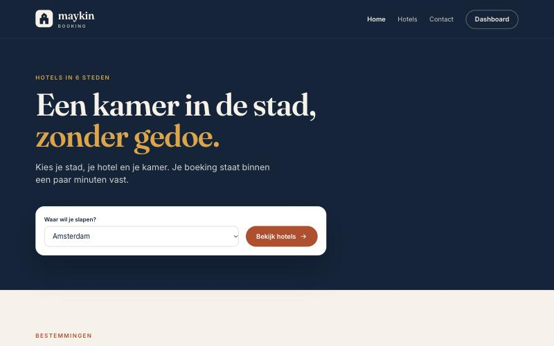
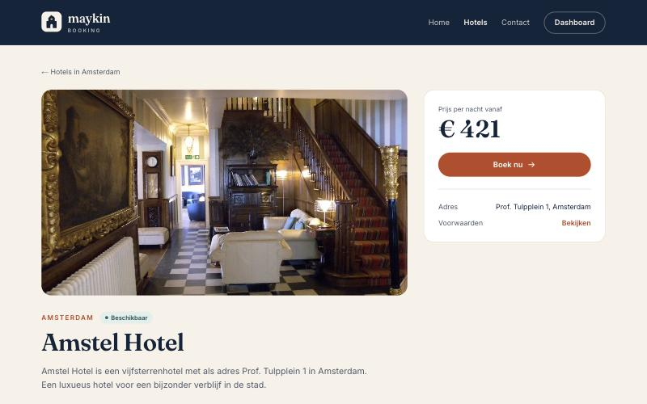
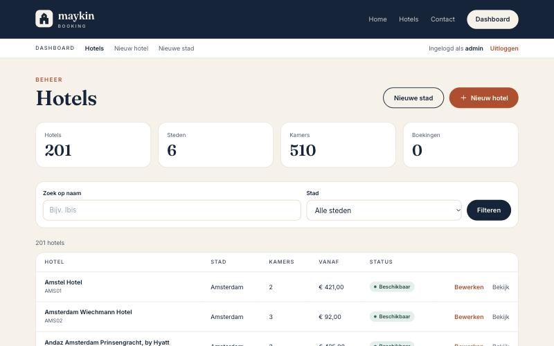

==============
Maykin Booking
==============

.. image:: https://github.com/ErhanCitil/maykin-booking/actions/workflows/ci.yml/badge.svg
   :target: https://github.com/ErhanCitil/maykin-booking/actions/workflows/ci.yml
   :alt: CI status

A Dutch-language hotel booking site built with Django: find a hotel, book a room
in three steps and manage hotels and rooms from a staff dashboard.

Screenshots
===========

*Homepage: choose a city and go straight to its hotels.*

*Hotel page (Amstel Hotel, Amsterdam), with the price per night and a button to
book.*

*Staff dashboard: all hotels, with search, a city filter and links to edit.*

.. list-table::
   :widths: 50 50

   * - .. image:: docs/screenshots/city.jpg
          :width: 400
          :alt: Hotels in Amsterdam, with a search field and prices per night

       Hotels in Amsterdam
     - .. image:: docs/screenshots/checkout.jpg
          :width: 400
          :alt: Checkout step 1, with dates and a choice of room

       Checkout, step 1 of 3

Features
========

For visitors
------------

* Pick a city on the homepage (``/``) or the city overview (``/hotels/``) and
  browse its hotels at ``/stad/<name>``, with search by name and 12 hotels per
  page. With check-in and check-out dates ("Inchecken", "Uitchecken"), only
  hotels with a free room for the whole stay are listed.
* Hotel page (``/hotel/<pk>``) with photo, address, highlights, rooms and
  prices per night.
* Three-step checkout (``/order/<pk>``, a django-formtools wizard):
  "Je verblijf" (dates, room and an optional discount code), "Je gegevens"
  (guest details) and "Controleren" (price per night, choice of payment, and
  accepting the terms). Only rooms that are free for the whole stay can be
  chosen.
* Availability per night: every room type has a number of rooms (5 by
  default), minus the bookings and the rooms that staff have blocked.
* Prices per night with a weekend surcharge (Friday and Saturday night),
  high-season surcharges, a discount for long stays and discount codes. The
  price of every night is fixed when the guest books.
* Pay at the hotel or online with iDEAL (Mollie, test mode only). An online
  booking holds the room (15 minutes by default). A payment that comes too
  late, twice or for another amount is refunded automatically.
* "Mijn boeking" (``/boeking/<token>/``): after booking, the guest gets a
  confirmation mail with the booking as PDF (WeasyPrint), the invoice and a
  link to this page. The page has the details, the PDFs and free cancellation
  up to and including two days before arrival (the deadline is 00:00 on the
  day before arrival). A cancellation gets a credit note, and an online
  payment is refunded.

Staff dashboard
---------------

* ``/dashboard/``, for staff only. Log in at ``/login/``; staff go straight to
  the dashboard.
* Two roles, as groups: "Receptie" (see bookings, cancel them, send mails
  again and retry refunds) and "Beheer" (everything). The superuser can do
  everything; staff without a role only see the home page.
* All hotels at a glance, with search by name and a filter per city.
* Add, edit and delete hotels: name, city, country, address, description,
  photo, terms and availability. An unavailable hotel is labelled "Vol" on the
  site.
* Manage the rooms of each hotel: type, price per night, number of rooms,
  description, photo and availability. Block rooms for a period, for example
  for maintenance.
* Hotels and rooms with bookings cannot be deleted.
* Add cities.
* Bookings (``/dashboard/boekingen/``): search by booking number, name or
  e-mail address, filter by city, hotel, status and arrival date, quick
  filters for today's arrivals and departures and for failed mails, and a CSV
  export of the filtered list.
* Booking page with the nights, the payments and refunds, a log of every
  status change and the mails sent. Staff can cancel a booking with a reason
  until the stay is over, send the last mail again (once per 2 minutes at
  most) and retry a refund that failed.
* Price rules (``/dashboard/prijsregels/``): weekend surcharge, discount for
  long stays and high seasons. Discount codes (``/dashboard/kortingscodes/``):
  a percentage or a fixed amount, a period of validity and a maximum number of
  uses.
* Invoices (``/dashboard/facturen/``), with search, filters, the PDFs and a
  CSV export. An invoice is made when a booking is confirmed, numbered per
  year without gaps (``2026-00001``), and never changes; a cancellation gets a
  credit note. VAT rates per country are in the Django admin (superuser only).
* Customers (``/dashboard/klanten/``): the bookings per e-mail address, with a
  CSV export.
* Report (``/dashboard/rapportage/``): occupancy and revenue without VAT per
  hotel for a period. Invoices without a VAT rate are not counted in the
  revenue, but listed apart.

Demo data
---------

* ``python src/manage.py load_demo_data`` loads 6 cities (Amsterdam,
  Antwerpen, Athene, Bangkok, Barcelona and Berlijn) with 201 real hotels from
  OpenStreetMap and 510 rooms.
* Prices are realistic but generated. The photos are freely licensed
  illustrations and don't show the hotel itself.
* Every hotel gets the country of its city. Only the Netherlands has a VAT
  rate, so bookings in the other cities get test invoices.
* The command is destructive: it first deletes all cities, hotels, rooms,
  bookings and reviews, with their invoices and payments (users are kept). It
  asks for confirmation, and only runs in development and CI, never over real
  invoices.
* How the dataset was made: see the `demo data README`_ (in Dutch).

Tech stack
==========

* Python 3.10 and Django 3.2
* PostgreSQL, plus Redis for cache and sessions with the production settings.
  Locally, SQLite is enough and Redis is not needed.
* django-formtools for the checkout, WeasyPrint for the PDF confirmation and
  the invoices
* Mollie for online payment (iDEAL, test mode only), with a fake provider for
  development and CI
* Tailwind CSS, loaded from a CDN, with the project's own colours and logo
* GitHub Actions for the tests and code quality (black, isort, flake8)

Quick start
===========

These steps run the site locally on SQLite, with the demo data. For
PostgreSQL, the frontend build, Docker and all settings, see `INSTALL.rst`_.

You need:

* Python 3.10
* Pango, which WeasyPrint uses for the PDF confirmation. The project does not
  start without it. On Debian or Ubuntu:

  .. code-block:: bash

      sudo apt-get install libpango-1.0-0 libpangoft2-1.0-0 libharfbuzz0b

  On macOS with Homebrew:

  .. code-block:: bash

      brew install pango

  For other systems, see the `WeasyPrint installation guide
  <https://doc.courtbouillon.org/weasyprint/stable/first_steps.html>`_.

Run all commands from the repository root.

1. Get the code:

   .. code-block:: bash

       git clone https://github.com/ErhanCitil/maykin-booking.git
       cd maykin-booking

2. Create a virtual environment and install the dependencies. Install pip
   below 24.1 first: ``maykin-django-two-factor-auth`` doesn't install with
   newer versions.

   .. code-block:: bash

       python3.10 -m venv env
       source env/bin/activate
       pip install "pip<24.1"
       pip install -r requirements/dev.txt

3. Create a ``.env`` file that switches the database to SQLite. The
   development settings already provide a ``SECRET_KEY``.

   .. code-block:: bash

       cat > .env <<'EOF'
       DB_ENGINE=django.db.backends.sqlite3
       DB_NAME=db.sqlite3
       EOF

4. Create the database and load the demo data. Type ``ja`` to confirm.

   .. code-block:: bash

       python src/manage.py migrate
       python src/manage.py load_demo_data

5. Create an admin account. You also use it to log in to the dashboard.

   .. code-block:: bash

       python src/manage.py createsuperuser

6. Start the development server:

   .. code-block:: bash

       python src/manage.py runserver

   The site runs at ``http://127.0.0.1:8000/``. Log in at
   ``http://127.0.0.1:8000/login/`` to open the dashboard.

You don't need the npm build from INSTALL.rst to try the site: the pages and
the dashboard load Tailwind from a CDN.

Tests and CI
============

Run the tests from the repository root:

.. code-block:: bash

    python src/manage.py test src

GitHub Actions (``.github/workflows/ci.yml``) runs two checks on every pull
request and every push to ``main``:

* **Tests**: installs ``requirements/ci.txt`` on Python 3.10 and runs the test
  suite with the ``maykinbooking.conf.ci`` settings against PostgreSQL 14.
* **Code quality**: checks ``src``, ``docs`` and ``bin`` with black, isort and
  flake8, using the versions from ``requirements/dev.txt``.

To run the same checks locally:

.. code-block:: bash

    DJANGO_SETTINGS_MODULE=maykinbooking.conf.ci SECRET_KEY=dummy python src/manage.py test src
    black --check src docs bin
    isort --check-only src docs bin
    flake8 src docs bin

The test command uses the database from your ``.env``. With the SQLite ``.env``
from the quick start, that is SQLite; CI uses PostgreSQL 14.

About the project
=================

Maykin Booking started as the Django case I built to apply for an internship at
Maykin Media. The case came with two CSV files of cities and hotels, which are
still in ``Case Maykin Media - Django - CSV data/``. I kept working on the
project during the internship.

Data and licenses
=================

* **Hotel data**: © `OpenStreetMap contributors
  <https://www.openstreetmap.org/copyright>`_, available under the
  `Open Database License (ODbL) 1.0
  <https://opendatacommons.org/licenses/odbl/1-0/>`_. The demo dataset
  (``hotels.json``) is a derived database; the `demo data README`_ explains how
  it was made.
* **Photos**: freely licensed photos from Wikimedia Commons and Flickr (found
  via Openverse), under CC0, CC BY, CC BY-SA or the Public Domain Mark. The
  maker, license and source of each photo are in `CREDITS.txt`_.

The site footer shows the same attribution.

Links
=====

* `Issues <https://github.com/ErhanCitil/maykin-booking/issues>`_
* `INSTALL.rst`_: full installation guide, settings and management commands

.. _INSTALL.rst: INSTALL.rst
.. _demo data README: src/maykinbooking/base/demo_data/README.md
.. _CREDITS.txt: src/maykinbooking/static/demo/CREDITS.txt
